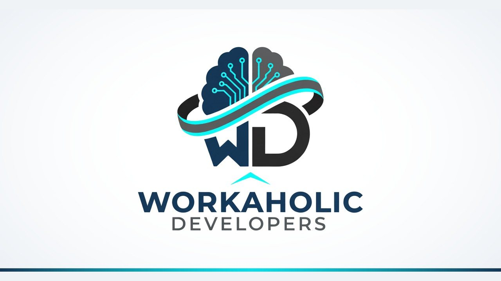

# Workaholic Developers

We are a software company with teams in India and Canada. We build and run our own products, make the Noodle games and a set of everyday apps, and build software for clients at a fixed price. Clients own the code we write for them. In Canada we work with our partner [Global Maple System](https://globalmaplesystem.com) in Winnipeg, which leads strategy and delivery while we do the engineering.

Website: [workaholicdevelopers.com](https://workaholicdevelopers.com)

## Products

| Product | What it does | Site |
| --- | --- | --- |
| [ClassTrack](https://workaholicdevelopers.com/classtrack) | The all-in-one education platform and LMS for Canadian colleges. | [classtrack.com](https://classtrack.com) |
| [SeeUAll](https://workaholicdevelopers.com/products/seeuall) | Video meetings that take attendance, write the minutes and file the recording. | [seeuall.com](https://seeuall.com) |
| [Mailaholic](https://workaholicdevelopers.com/products/mailaholic) | Business email on your own domain, without Google or Microsoft. | [mailaholic.email](https://mailaholic.email) |
| [Proctly](https://workaholicdevelopers.com/products/proctly) | Online exam proctoring that records every screen, the webcam and the room. | [proctly.com](https://proctly.com) |
| [ChatOnTime](https://workaholicdevelopers.com/products/chatontime) | Live chat for your website, with a team inbox and AI replies. | [chatontime.com](https://chatontime.com) |
| [Architect World](https://workaholicdevelopers.com/products/architectworld) | Studio management and a client portal for architects, with a directory of verified studios. | [thearchitectworld.com](https://thearchitectworld.com) |

ClassTrack is engineered and scaled by Workaholic Developers and delivered across Canada by EduWeb Consulting. The repositories pinned below describe each product; their source code is private.

## Noodle games

30 free games starring Noodle: board games, sports, puzzles, runners and cosy cafés that open in the browser on any phone. See [all Noodle games](https://workaholicdevelopers.com/games) or the [noodle-games](https://github.com/workaholicdevelopers/noodle-games) repository.

## Everyday apps

20 small apps for iPhone and Android that each do one everyday job: family safety, group trip planning, pill reminders, bills and budgets, document scanning, passport photos, legal documents and more. The phone apps are coming soon; [Dastavo](https://workaholicdevelopers.com/apps/dastavo-legal-document-maker), the legal document maker, already works in the browser. See [the apps](https://workaholicdevelopers.com/apps) or the [everyday-apps](https://github.com/workaholicdevelopers/everyday-apps) repository.

## Free tools

Free online tools that run in the browser: calculators, converters, file tools, developer utilities and small games. See [workaholicdevelopers.com/tools](https://workaholicdevelopers.com/tools).

## What we build for clients

- Websites and web apps
- iPhone and Android apps
- Custom and enterprise software: portals, dashboards, ERP, LMS and CRM
- AI agents and automation
- Online stores
- Games
- APIs and integrations
- Cloud, hosting and domains
- UI and UX design
- Maintenance and support

## Contact

- Website: https://workaholicdevelopers.com
- Email: info@workaholicdevelopers.com
- Start a project: https://workaholicdevelopers.com/contact
